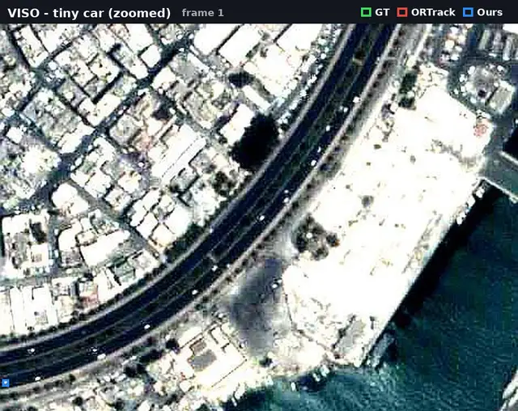

<div align="center">

# KDI Tracker: 무인기 영상 단일 객체 추적

김동훈 · 전북대학교

</div>

<p align="center">
  
</p>

<p align="center"><sub>초록: 정답 · 빨강: ORTrack · 파랑: Look Twice (우리) · BioDrone, 심한 카메라 흔들림</sub></p>

## 개요

첫 프레임에 표적 박스 하나만 주면, 검출기 없이 그 표적 하나를 영상 끝까지 따라갑니다.
멀티콥터·날갯짓 드론, 1fps 유인기, 표적이 몇 픽셀뿐인 위성 영상, 열화상처럼
촬영 조건이 크게 다른 영상에서 모두 버티는 것이 목표입니다.

## 문제

<p align="center">
  
</p>

경량 추적기(ORTrack 등)는 무인기 영상에서 세 가지로 실패합니다.

1. **오추적**: 비슷한 물체로 박스가 넘어간 뒤 그 물체를 계속 따라갑니다.
2. **흔들림**: 카메라가 갑자기 움직이면 표적이 검색 영역 밖으로 튀어 나갑니다.
3. **작은 표적**: 몇 픽셀짜리 표적은 영상을 줄이는 순간 사라집니다.

## 방법

**Look Twice** (학습 없음, 완료). 매 프레임 두 곳을 동시에 찾습니다. 표적이 있던 자리와,
카메라만 움직였다면 표적이 가 있을 자리(특징점 흐름으로 추정)입니다. 둘 중 더 확실한
쪽을 고릅니다. 카메라 추정이 틀려도 원래 자리가 남아 있어 손해가 거의 없습니다. 2번 문제를 풉니다.

**학생 추적기** (구현 완료, 학습 중). 세 문제를 한 네트워크로 풉니다. SAM3를 교사로 학습하며,
SAM3는 학습 때만 쓰고 실제 추적은 작은 학생 혼자 합니다.

| 문제 | 학생이 하는 일 |
|---|---|
| 오추적 | 후보마다 "원래 표적 / 해당 없음"을 판단하고, 확실할 때만 기억을 갱신합니다. 표적이 어떻게 생겼는지는 SAM3의 기억 표현을 보고 배웁니다. |
| 흔들림 | 카메라 움직임으로 예측한 위치와 넓은 영역에 위치 후보를 여러 개 두고 하나를 고릅니다. Look Twice를 학습형으로 넓힌 것입니다. |
| 작은 표적 | 원본 해상도에서 세부 특징을, 축소 영상에서 주변 문맥을 따로 읽습니다. |

<p align="center">
  
</p>

**계획.** OSTrack에서 시작해 모듈을 하나씩 붙입니다(흔들림 → 작은 표적 → 오추적 + SAM3).
각 단계를 GOT-10k로 학습하고, 아래 검증셋에서 효과를 매번 확인합니다.

## 결과

### 정량 결과

통합 검증셋: 10종 데이터셋 × 30개 시퀀스, Success AUC (%).

<p align="center">
  
</p>

| 데이터 | 종류 | ORTrack | **Look Twice** | OSTrack (ViT-B) |
|---|---|---:|---:|---:|
| VETRA | 유인기, 1fps | 8.21 | **42.75** | 9.42 |
| BIRDSAI | 고정익, 열화상 | 31.96 | **39.45** | 29.13 |
| BioDrone | 날갯짓 드론 | 34.37 | **40.92** | 40.57 |
| UAV123 | 멀티콥터 | 62.44 | 62.88 | **67.21** |
| DTB70 | 멀티콥터 | 70.85 | 70.99 | **72.05** |
| UAVDT | 멀티콥터 | 57.11 | 57.93 | **59.37** |
| VisDrone2018 | 멀티콥터 | **68.52** | 68.60 | 67.65 |
| SV248S | 위성, 극소형 | 18.30 | **25.16** | 16.21 |
| SatSOT | 위성, 극소형 | 34.77 | **37.15** | 37.12 |
| VISO | 위성, 극소형 | 31.49 | **39.75** | 32.19 |
| **평균** | | 41.80 | **48.56** | 43.09 |

<p align="center">
  
</p>

Look Twice는 평균에서 ORTrack보다 +6.8, 더 큰 OSTrack보다 +5.5 높습니다.
이득은 흔들림·저프레임·극소형 표적 영상에서 나오고, 일반 멀티콥터 영상에서는 OSTrack이 2~4점 높습니다.

<sub>SV248S는 첫 프레임 정답이 없는 2개를 모든 방법에서 빼고 28개로 계산했습니다. Look Twice 수치는 화면 밖 추적을 끈 설정입니다.</sub>

### 정성 결과

| VETRA (1fps, 큰 이동) | VISO (작은 차량, 확대) |
|---|---|
|  |  |
| AUC 0.3 → 79.7 | AUC 14.8 → 50.1 |

<sub>초록: 정답 · 빨강: ORTrack · 파랑: Look Twice. 이득이 가장 큰 시퀀스를 골랐습니다. 원본 영상: [BioDrone](assets/demo_biodrone.mp4) · [VETRA](assets/demo_vetra.mp4) · [VISO](assets/demo_viso.mp4)</sub>

## 시작하기

```bash
cd tracker && bash run_looktwice.sh uav123   # Look Twice 실행 (공식 ORTrack 가중치)
python eval/make.py                          # 10종 검증셋 만들기
python eval/score_ostrack.py                 # AUC 표 만들기
```

설치와 코드 구성: [docs/GETTING_STARTED.md](docs/GETTING_STARTED.md)

## 참고

[ORTrack](https://github.com/wuyou3474/ORTrack)과 [OSTrack](https://github.com/botaoye/OSTrack)을 기반으로 하며,
교사 모델은 [SAM3](https://github.com/facebookresearch/sam3)입니다.
이전 Hailo·MOT 작업은 [`archive-hailo-mot`](https://github.com/kdh044/uav-sot/tree/archive-hailo-mot) 브랜치에 있습니다.
