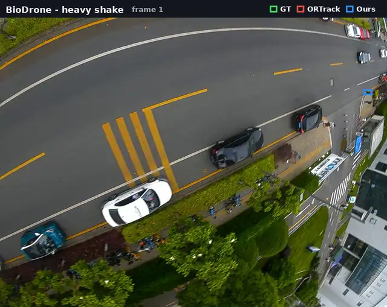
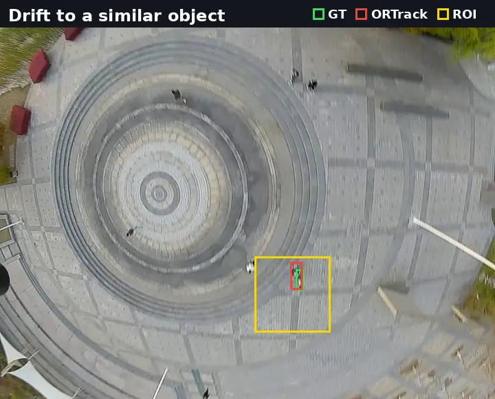
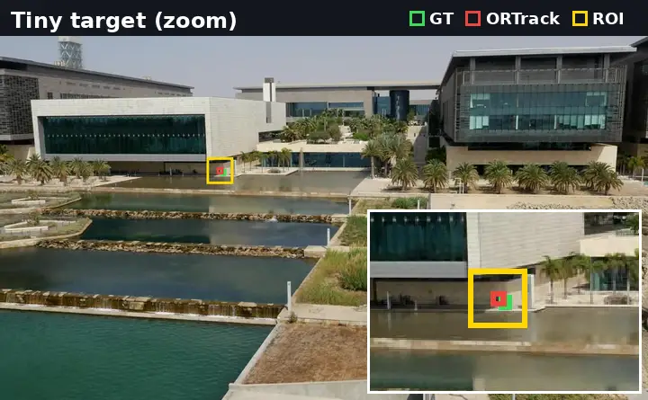
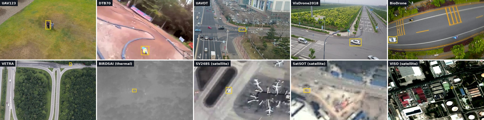

# KDI Tracker: 무인기 영상 단일 객체 추적

김동훈 · 전북대학교

  

초록: 정답 · 빨강: ORTrack · 파랑: Ours · BioDrone, 심한 카메라 흔들림

## 문제

경량 추적기의 무인기 영상 실패 유형 3가지

| 오추적 | 흔들림 (ROI 이탈) | 작은 표적 |
|:---:|:---:|:---:|
|  |  |  |
| 비슷한 물체로 넘어가 계속 추적 | 카메라 움직임으로 표적이 ROI 밖으로 이탈 | 몇 픽셀 표적이 축소 과정에서 소실 |

초록: 정답 · 빨강: ORTrack · 노랑: ROI

- 실패 시작 시 표적이 ROI 밖에 있던 비율: BioDrone **73%** · BIRDSAI **51%** · UAV123 25%

## 방법

### 1. 흔들림 → ROI 두 곳 탐색

- 직전 위치 ROI $A_t$와 카메라 움직임 $H_{t-1\to t}$만큼 옮긴 ROI $B_t$를 함께 탐색, 점수 $s$가 높은 쪽 선택

$$A_t = b_{t-1},\qquad B_t = H_{t-1\to t}(b_{t-1}),\qquad b_t = \arg\max_{R\in\{A_t,\,B_t\}} s(R)$$

### 2. 작은 표적 → 박스 최소 크기 완화

- 출력 박스 최소 크기를 10px 고정에서 첫 프레임 표적 크기로 완화

$$\min(w_t, h_t) \ge 10 \quad\longrightarrow\quad \min(w_t, h_t) \ge \min\big(10,\ w_0,\ h_0\big)$$

### 3. 오추적 → 원래 표적 여부 판단

- 후보 $K$개와 "없음" $\varnothing$ 중 선택, 확신도 $q_t$가 높을 때만 기억 $M$ 갱신

$$\hat k = \arg\max_{k\in\{1,\dots,K,\ \varnothing\}} p_k,\qquad M_t = \begin{cases} \text{update}(M_{t-1}, b_t) & q_t \ge \tau \\ M_{t-1} & \text{otherwise}\end{cases}$$

### 4. 교사 학습 (SAM3 증류)

- SAM3의 마스크·포인터·기억을 경량 추적기가 모방, SAM3가 정답과 맞는 프레임만 사용
- 추론 시 경량 추적기만 사용

$$\mathcal{L} = \mathcal{L}_{\text{GT}} + \lambda\,\mathbb{1}\big[\text{IoU}(\text{SAM3}, \text{GT}) \ge 0.5\big]\big(\mathcal{L}_{\text{mask}} + \mathcal{L}_{\text{ptr}} + \mathcal{L}_{\text{mem}}\big)$$

| 방법 | 1. 흔들림 | 2. 작은 표적 | 3. 오추적 | 4. 교사 학습 |
|---|:---:|:---:|:---:|:---:|
| 상태 | ✅ | ✅ | 학습 중 | 학습 중 |

## 결과

### 정량 결과

- 10종 데이터셋 × 30개 시퀀스, Success AUC (%)

  

| 데이터 | 종류 | ORTrack | **+ Ours** | OSTrack (ViT-B) | **+ Ours** |
|---|---|---:|---:|---:|---:|
| VETRA | 유인기, 1fps | 8.21 | 42.75 | 9.42 | **44.28** |
| BIRDSAI | 고정익, 열화상 | 31.96 | **39.45** | 29.13 | 35.45 |
| BioDrone | 날갯짓 드론 | 34.37 | 40.92 | 40.57 | **44.19** |
| UAV123 | 멀티콥터 | 62.44 | 62.88 | **67.21** | 64.59 |
| DTB70 | 멀티콥터 | 70.85 | 70.99 | 72.05 | **73.28** |
| UAVDT | 멀티콥터 | 57.11 | 57.93 | 59.37 | **61.95** |
| VisDrone2018 | 멀티콥터 | 68.52 | 68.60 | 67.65 | **69.07** |
| SV248S | 위성, 극소형 | 18.30 | 25.16 | 16.21 | **26.13** |
| SatSOT | 위성, 극소형 | 34.77 | 37.15 | 37.12 | **41.05** |
| VISO | 위성, 극소형 | 31.49 | 39.75 | 32.19 | **43.89** |
| **평균** |  | 41.80 | 48.56 | 43.09 | **50.39** |

  

- **+ Ours**: 각 추적기 공식 가중치에 방법 1·2만 적용 (학습 없음), 평균 **+6.8 ~ +7.3**

SV248S: 첫 프레임 정답 없는 2개 제외, 28개로 계산

### 정성 결과

| VETRA (1fps, 큰 이동) | VISO (작은 차량, 확대) |
|---|---|
|  |  |
| AUC 0.3 → 79.7 | AUC 14.8 → 50.1 |

초록: 정답 · 빨강: ORTrack · 파랑: Ours · 원본 영상: [BioDrone](assets/demo_biodrone.mp4) · [VETRA](assets/demo_vetra.mp4) · [VISO](assets/demo_viso.mp4)
