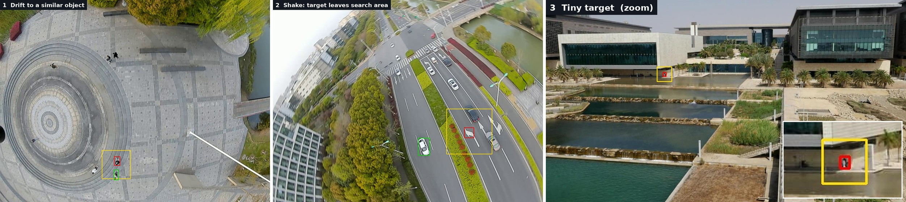
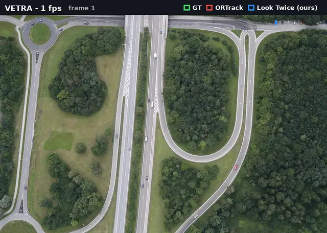

# KDI Tracker: 무인기 영상 단일 객체 추적 (SOT)

첫 프레임에 표적 박스 하나만 주면, 이후 영상에서 **그 표적 하나를 끝까지 따라가는** 추적기입니다. 검출기 없이 동작합니다. 드론·유인기·위성·열화상처럼 촬영 조건이 크게 다른 영상에서도 같은 추적기가 버티도록 하는 것이 목표입니다.

> - 기반 추적기: [ORTrack](https://github.com/wuyou3474/ORTrack) (CVPR'25, 경량 ViT) · 비교: [OSTrack](https://github.com/botaoye/OSTrack) (ECCV'22, ViT-B)
> - 평가: 10종 데이터셋에서 30개씩 뽑은 **통합 val 300개 시퀀스**
> - 지식증류 교사: [SAM3](https://github.com/facebookresearch/sam3) (학습 때만 사용, 추론에는 쓰지 않음)


<sub>BioDrone `frame_437` (날갯짓 드론, 심한 흔들림) · 초록 GT, 빨강 ORTrack, 파랑 Look Twice · AUC 0.6 → 76.4 · [원본 영상](assets/demo_biodrone.mp4)</sub>

## 한눈에 보기

| 문제 | 우리 구조 | 상태 |
|---|---|---|
| ① 표적을 놓친 뒤 다른 물체를 계속 따라감 | **정체성 유지 디코더 + SAM3 지식증류** | 구현 완료, 본학습 전 |
| ② 작은 표적을 못 잡음 | **원본 해상도 세부 특징 + 넓은 문맥 특징** | 구현 완료, 본학습 전 |
| ③ 카메라가 크게 흔들리면 표적이 검색 영역 밖으로 튐 | **복수 위치 가설** (규칙판 = Look Twice) | Look Twice 결과 있음 |

| 통합 val 10종 평균 AUC | ORTrack | OSTrack (ViT-B) | **Look Twice (우리)** |
|---|---:|---:|---:|
| Success AUC (%) | 41.80 | 43.09 | **48.56** |

---

## 1. 풀려는 문제

**이 그림은?** 경량 추적기 ORTrack이 무인기 영상에서 실패하는 세 가지 장면입니다. 초록이 정답, 빨강이 ORTrack, 노랑이 ORTrack이 보고 있는 검색 영역입니다.



1. **비슷한 물체로 옮겨 감**: 표적 옆의 비슷한 사람으로 박스가 넘어간 뒤, 그 사람을 정답이라고 믿고 계속 따라갑니다.
2. **흔들림으로 검색 영역 이탈**: 카메라가 크게 움직이면 표적(초록)이 검색 영역(노랑) 밖으로 튀어 나가 다시 찾지 못합니다. 흔들림이 큰 BioDrone에서는 실패의 73%가 이렇게 시작합니다.
3. **작은 표적**: 표적이 수 픽셀이면 영상을 줄이는 순간 정보가 사라집니다. ORTrack은 박스를 최소 10px로 강제해 손해를 더 봅니다.

---

## 2. 구조

**이 그림은?** 우리 추적기(아래 줄, 학생)와 학습 때만 쓰는 SAM3 교사(위 줄)입니다. 점선 화살표가 증류 신호입니다. 추론 때는 학생만 돌아갑니다.


| 모듈 | 하는 일 | 겨냥하는 문제 |
|---|---|---|
| 세부 + 문맥 두 갈래 특징 | 원본 해상도에서 세부 특징을, 축소 영상에서 넓은 문맥을 따로 뽑음 | ② 작은 표적 |
| 복수 위치 가설 | 카메라 움직임 예측 위치와 넓은 영역에 후보 위치를 함께 둠 | ③ 흔들림 |
| 정체성 유지 디코더 | 후보마다 "원래 표적 / 해당 없음"을 판단하고, 확실하지 않으면 기억을 갱신하지 않음 | ① 오추적 |
| SAM3 지식증류 | SAM3의 전경 마스크·객체 포인터(256D)·기억 표현(64D)을 학생이 따라 배움 | ① 오추적 |

> SAM3 출력이 틀린 프레임(빈 마스크, 정답과 불일치)은 학습 GT로 걸러 증류에서 뺍니다.
> 같은 구조를 GT로만 학습한 모델을 대조군으로 두어 증류의 효과를 따로 잽니다.

---

## 3. 결과: 통합 val 10종

**이 그림은?** 평가에 쓴 10종 데이터의 예시입니다. 노란 박스가 추적할 표적입니다. 일반 드론 영상부터 1fps 유인기, 열화상, 수 픽셀짜리 위성 표적까지 섞여 있습니다.


**이 그림은?** 세 추적기를 같은 300개 시퀀스에서 돌린 Success AUC입니다.


| 데이터 | 종류 | ORTrack | **Look Twice** | OSTrack |
|---|---|---:|---:|---:|
| VETRA | 유인기, 1fps | 8.21 | **42.75** | 9.42 |
| BIRDSAI | 고정익 열화상 | 31.96 | **39.45** | 29.13 |
| BioDrone | 날갯짓 드론 | 34.37 | **40.92** | 40.57 |
| UAV123 | 멀티콥터 | 62.44 | 62.88 | **67.21** |
| DTB70 | 멀티콥터 | 70.85 | 70.99 | **72.05** |
| UAVDT | 멀티콥터 | 57.11 | 57.93 | **59.37** |
| VisDrone2018 | 멀티콥터 | **68.52** | 68.60 | 67.65 |
| SV248S | 위성, 극소형 | 18.30 | **25.16** | 16.21 |
| SatSOT | 위성, 극소형 | 34.77 | **37.15** | 37.12 |
| VISO | 위성, 극소형 | 31.49 | **39.75** | 32.19 |
| **평균** | | 41.80 | **48.56** | 43.09 |

| VETRA (1fps, 큰 이동) | VISO (극소형, 확대) |
|---|---|
|  |  |
| <sub>AUC 0.3 → 79.7 · [원본 영상](assets/demo_vetra.mp4)</sub> | <sub>AUC 14.8 → 50.1 · [원본 영상](assets/demo_viso.mp4)</sub> |

**정리**

- **Look Twice가 10종 평균 48.56으로 가장 높습니다.** ORTrack보다 +6.8, 더 무거운 OSTrack(ViT-B)보다 +5.5입니다.
- 이득은 흔들림·저프레임·극소형 표적에 몰려 있습니다(VETRA +34.5, BIRDSAI +7.5, VISO +8.3, SV248S +6.9).
- 일반 멀티콥터 영상(UAV123·DTB70·UAVDT)에서는 OSTrack이 2~4점 높습니다. 백본 크기 차이입니다.

> Look Twice는 학습 없는 규칙판입니다. ORTrack 공식 가중치에 "직전 위치 + 카메라 움직임만큼 옮긴 위치"를 함께 보고 점수가 높은 쪽을 고르는 로직만 더했습니다. 위 수치는 화면 밖 추적(`SOT_OOV`)을 끈 설정입니다.
> SV248S는 첫 프레임 정답이 없는 2개 시퀀스를 모든 방법에서 똑같이 빼고 28개로 계산했습니다.

---

## 4. 직접 돌려보기

**필요한 것:** PyTorch, 공식 ORTrack-DeiT 가중치(`tracker/README.md` 참고), 통합 val 원본 데이터.

```bash
python eval/make.py                                     # 1) 10종에서 30개씩 뽑아 통합 val 만들기
cd tracker && bash run_looktwice.sh uav123              # 2) Look Twice 실행 (데이터 이름별)
bash eval/run_ostrack.sh uav123 dtb70                   # 3) 비교용 원본 OSTrack 실행
python eval/score_ostrack.py                            # 4) 10종 AUC 표 만들기
```

> 학습 가중치와 데이터셋은 저장소에 포함하지 않습니다. 데이터 경로는 각 `local.py`에서 맞춥니다.

**파일 구조**

| 파일 | 하는 일 |
|---|---|
| `tracker/` | Look Twice 추적기 (ORTrack 기반, 바로 실행 가능) |
| `tracker/lib/test/tracker/sm_track.py` | Look Twice 핵심 로직 (`track_simple`) |
| `tracker/lib/test/tracker/motion_prior.py` | 카메라 움직임 추정 (특징점 추적 + 호모그래피) |
| `recovery_tracker/student.py` | 학생 추적기 (세부/문맥 특징, 위치 가설, 디코더) |
| `recovery_tracker/query_decoder.py` | 정체성 유지 디코더 |
| `recovery_tracker/losses.py` | GT 손실과 SAM3 증류 손실 |
| `recovery_tracker/train.py` | 학습 |
| `eval/` | 통합 val 구성, 실행·채점 스크립트, 결과(`results_subset10.txt`) |
| `assets/` | README 그림과 데모 영상 |

---

## 다음 계획

1. 일반 SOT 학습 데이터(GOT-10k 등)에서 SAM3 교사 출력을 뽑고 학생 추적기를 본학습합니다.
2. 같은 통합 val 10종에서 GT만 학습한 모델, Look Twice, OSTrack과 비교합니다.
3. 세 모듈을 하나씩 빼 보며 각 모듈의 기여를 확인합니다.

## 참고

- `tracker/`는 [ORTrack](https://github.com/wuyou3474/ORTrack) 공식 코드를 고친 것이며 원래 저장소의 라이선스를 따릅니다.
- 이전 Hailo·MOT·RemDet 작업은 [`archive-hailo-mot`](https://github.com/kdh044/uav-sot/tree/archive-hailo-mot) 브랜치에 있습니다.
