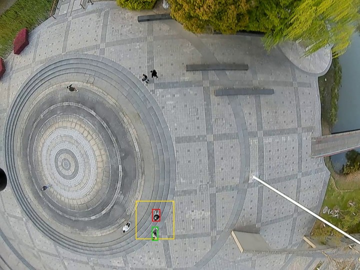
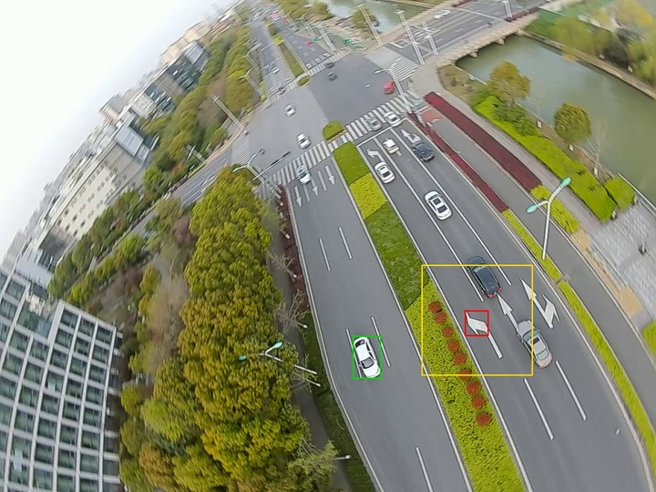
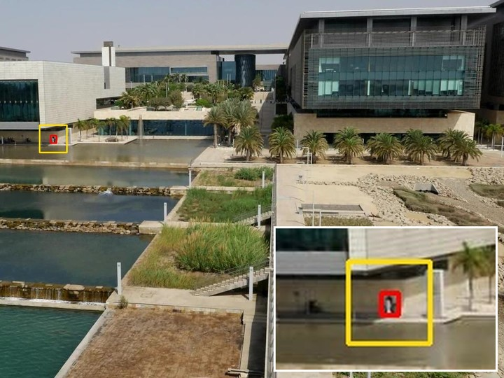
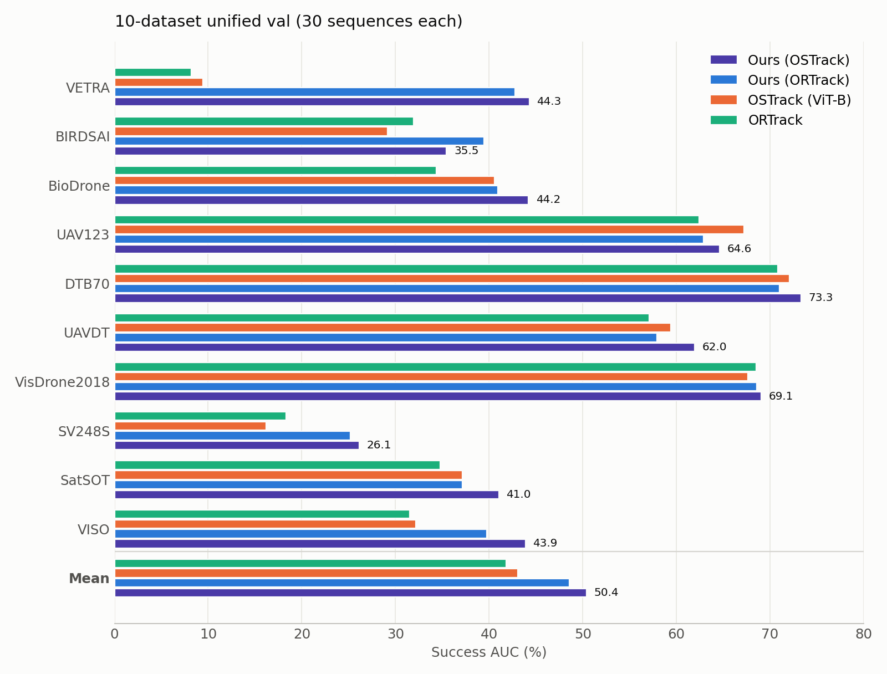

<div align="center">

# KDI Tracker: 무인기 영상 단일 객체 추적

김동훈 · 전북대학교

</div>

<p align="center">
  
</p>

<p align="center"><sub>초록: 정답 · 빨강: ORTrack · 파랑: Ours · BioDrone, 심한 카메라 흔들림</sub></p>

## 문제

경량 추적기는 무인기 영상에서 세 가지로 실패합니다.

| 오추적 | 흔들림 (ROI 이탈) | 작은 표적 |
|:---:|:---:|:---:|
|  |  |  |
| 비슷한 물체로 넘어가 계속 따라감 | 카메라가 움직이면 표적이 ROI(검색 영역) 밖으로 나가 다시 못 찾음 | 몇 픽셀짜리 표적이 축소 과정에서 사라짐 |

<sub>초록: 정답 · 빨강: ORTrack · 노랑: ROI(검색 영역)</sub>

실패가 시작될 때 표적이 이미 ROI 밖에 있던 비율: BioDrone **73%** · BIRDSAI **51%** · UAV123 25%.
흔들림이 큰 영상일수록 실패 대부분이 ROI 이탈에서 시작합니다.

## 방법

| 문제 | 방법 |
|---|---|
| 오추적 | 후보가 원래 표적인지 판단하고, 확실할 때만 기억을 갱신 |
| 흔들림 (ROI 이탈) | ROI를 원래 자리와 카메라가 움직인 자리 두 곳에 두고 더 확실한 쪽을 선택 |
| 작은 표적 | 원본 해상도의 세부 특징과 축소 영상의 문맥을 따로 읽음 |

**교사 학습**: SAM3를 교사로 두고, 표적을 알아보는 능력을 경량 추적기에 증류합니다. SAM3는 학습 때만 씁니다.

## 결과

### 정량 결과

10종 데이터셋 × 30개 시퀀스, Success AUC (%).

<p align="center">
  
</p>

| 데이터 | 종류 | ORTrack | OSTrack (ViT-B) | **Ours** |
|---|---|---:|---:|---:|
| VETRA | 유인기, 1fps | 8.21 | 9.42 | **42.75** |
| BIRDSAI | 고정익, 열화상 | 31.96 | 29.13 | **39.45** |
| BioDrone | 날갯짓 드론 | 34.37 | 40.57 | **40.92** |
| UAV123 | 멀티콥터 | 62.44 | **67.21** | 62.88 |
| DTB70 | 멀티콥터 | 70.85 | **72.05** | 70.99 |
| UAVDT | 멀티콥터 | 57.11 | **59.37** | 57.93 |
| VisDrone2018 | 멀티콥터 | 68.52 | 67.65 | **68.60** |
| SV248S | 위성, 극소형 | 18.30 | 16.21 | **25.16** |
| SatSOT | 위성, 극소형 | 34.77 | 37.12 | **37.15** |
| VISO | 위성, 극소형 | 31.49 | 32.19 | **39.75** |
| **평균** | | 41.80 | 43.09 | **48.56** |

<p align="center">
  
</p>

<sub>Ours는 현재 흔들림·작은 표적 방법까지 적용한 학습 없는 버전(공식 ORTrack 가중치)입니다. 오추적 방법과 교사 학습은 학습 중입니다. SV248S는 첫 프레임 정답이 없는 2개를 빼고 28개로 계산했습니다.</sub>

### 정성 결과

| VETRA (1fps, 큰 이동) | VISO (작은 차량, 확대) |
|---|---|
|  |  |
| AUC 0.3 → 79.7 | AUC 14.8 → 50.1 |

<sub>초록: 정답 · 빨강: ORTrack · 파랑: Ours. 원본 영상: [BioDrone](assets/demo_biodrone.mp4) · [VETRA](assets/demo_vetra.mp4) · [VISO](assets/demo_viso.mp4)</sub>

## 시작하기

```bash
cd tracker && bash run_looktwice.sh uav123   # 실행 (공식 ORTrack 가중치)
python eval/make.py                          # 10종 검증셋 만들기
python eval/score_ostrack.py                 # AUC 표 만들기
```

설치와 코드 구성: [docs/GETTING_STARTED.md](docs/GETTING_STARTED.md)
