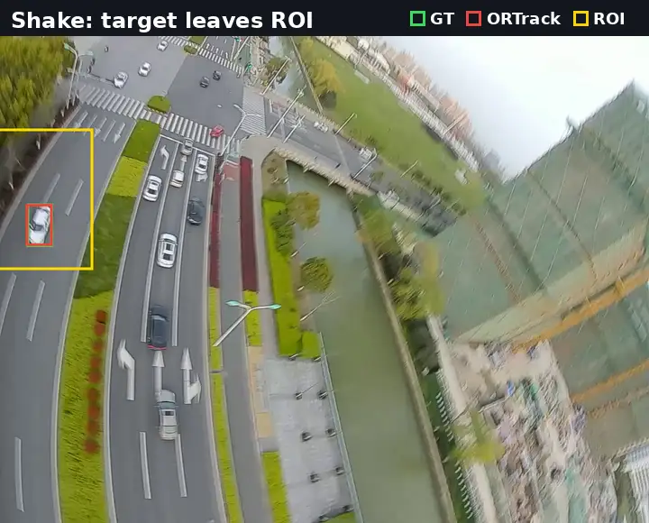
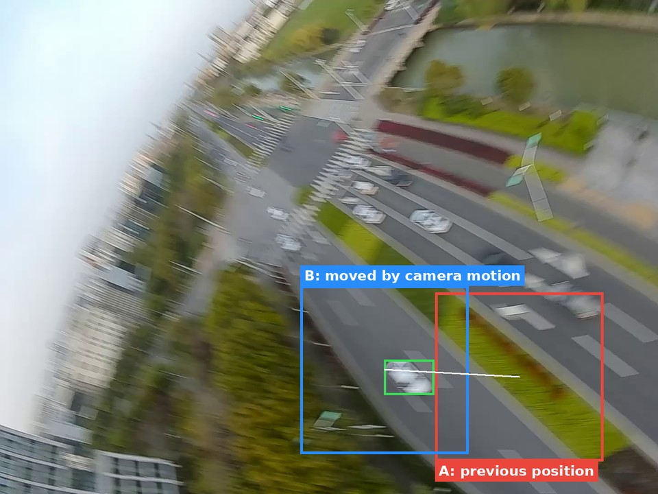
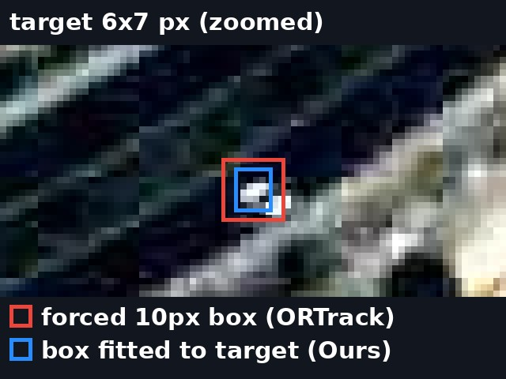

# KDI Tracker: 무인기 영상 단일 객체 추적

김동훈 · 전북대학교

  

초록: 정답 · 빨강: ORTrack · 파랑: Ours · BioDrone, 심한 카메라 흔들림

## 문제

경량 추적기는 무인기 영상에서 세 가지로 실패합니다.

| 오추적 | 흔들림 (ROI 이탈) | 작은 표적 |
|:---:|:---:|:---:|
|  |  |  |
| 비슷한 물체로 넘어가 계속 따라감 | 카메라가 움직이면 표적이 ROI(검색 영역) 밖으로 나가 다시 못 찾음 | 몇 픽셀짜리 표적이 축소 과정에서 사라짐 |

초록: 정답 · 빨강: ORTrack · 노랑: ROI(검색 영역)

실패가 시작될 때 표적이 이미 ROI 밖에 있던 비율: BioDrone **73%** · BIRDSAI **51%** · UAV123 25%.
흔들림이 큰 영상일수록 실패 대부분이 ROI 이탈에서 시작합니다.

## 방법

### 1. 흔들림 → ROI를 두 곳에 띄운다

카메라가 홱 돌면 표적은 화면에서 반대로 튑니다. 원래 추적기는 **A(직전 위치)**만 보다가 표적(초록)을 놓칩니다.
우리는 배경이 움직인 만큼 ROI를 옮긴 **B**를 하나 더 띄우고, 둘 중 표적이 더 확실하게 보이는 쪽을 고릅니다.
카메라 추정이 틀려도 A가 남아 있어서 손해가 없습니다.

### 2. 작은 표적 → 박스를 표적 크기에 맞춘다

원래 추적기는 출력 박스를 최소 10px로 고정해서, 6px짜리 차량에도 10px 박스(빨강)를 냅니다. 위치가 맞아도 점수가 깎입니다.
우리는 첫 프레임 표적 크기까지 박스를 줄일 수 있게 했습니다(파랑). 앞으로 원본 해상도에서 세부 특징을 읽는 갈래도 붙입니다.

### 3. 오추적 → "원래 표적인가?"를 따로 묻는다

원래 추적기는 점수가 가장 높은 곳을 무조건 표적으로 정하고, 그 모습을 기억합니다. 한 번 비슷한 물체로 넘어가면 돌아오지 못합니다.
우리는 후보마다 **원래 표적인지 / 없음**을 판단하고, 확실할 때만 기억을 갱신합니다. 표적이 가려지면 엉뚱한 물체 대신 "없음"을 냅니다.

### 교사 학습

"원래 표적인가?"를 판단하는 능력은 SAM3(대형 분할 모델)에게서 배웁니다. SAM3가 표적을 보는 방식(마스크·기억)을 경량 추적기가 따라 하도록 학습하고, 실제 추적 때는 경량 추적기만 씁니다.

| | 흔들림 | 작은 표적 | 오추적 + 교사 학습 |
|---|:---:|:---:|:---:|
| 상태 | ✅ 적용 | ✅ 박스 크기 적용 · 세부 특징 학습 중 | 학습 중 |

## 결과

### 정량 결과

10종 데이터셋 × 30개 시퀀스, Success AUC (%).

  

| 데이터 | 종류 | ORTrack | **+ Ours** | OSTrack (ViT-B) | **+ Ours** |
|---|---|---:|---:|---:|---:|
| VETRA | 유인기, 1fps | 8.21 | 42.75 | 9.42 | **44.28** |
| BIRDSAI | 고정익, 열화상 | 31.96 | **39.45** | 29.13 | 35.45 |
| BioDrone | 날갯짓 드론 | 34.37 | 40.92 | 40.57 | **44.19** |
| UAV123 | 멀티콥터 | 62.44 | 62.88 | **67.21** | 64.59 |
| DTB70 | 멀티콥터 | 70.85 | 70.99 | 72.05 | **73.28** |
| UAVDT | 멀티콥터 | 57.11 | 57.93 | 59.37 | **61.95** |
| VisDrone2018 | 멀티콥터 | 68.52 | 68.60 | 67.65 | **69.07** |
| SV248S | 위성, 극소형 | 18.30 | 25.16 | 16.21 | **26.13** |
| SatSOT | 위성, 극소형 | 34.77 | 37.15 | 37.12 | **41.05** |
| VISO | 위성, 극소형 | 31.49 | 39.75 | 32.19 | **43.89** |
| **평균** |  | 41.80 | 48.56 | 43.09 | **50.39** |

  

+ Ours는 각 추적기의 공식 가중치에 흔들림·작은 표적 방법만 붙인 학습 없는 버전입니다. 두 추적기 모두 평균이 6.8~7.3점 오릅니다. 오추적 방법과 교사 학습은 학습 중입니다. SV248S는 첫 프레임 정답이 없는 2개를 빼고 28개로 계산했습니다.

### 정성 결과

| VETRA (1fps, 큰 이동) | VISO (작은 차량, 확대) |
|---|---|
|  |  |
| AUC 0.3 → 79.7 | AUC 14.8 → 50.1 |

초록: 정답 · 빨강: ORTrack · 파랑: Ours. 원본 영상: [BioDrone](assets/demo_biodrone.mp4) · [VETRA](assets/demo_vetra.mp4) · [VISO](assets/demo_viso.mp4)
