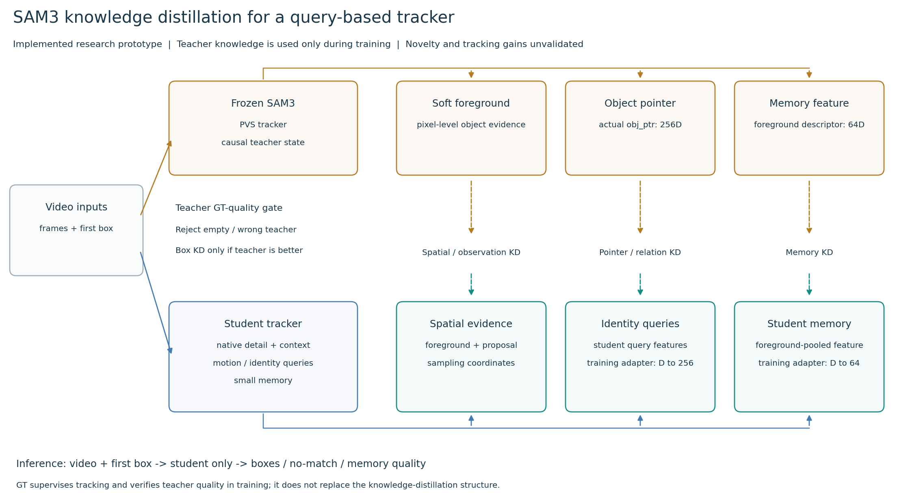

# KDI Tracker: Single Object Tracking for UAV Videos

DongHun Kim · Jeonbuk National University

[Results](docs/RESULTS.md) · [Getting started](docs/GETTING_STARTED.md)

  

  
  

Green: GT · Red: ORTrack · Blue: Look Twice (ours) — BioDrone (shake) · VETRA (1 fps) · VISO (tiny, zoomed)

## News

- **[2026/11/23]** Unified 10-dataset validation set: Look Twice 48.6 AUC vs. ORTrack 41.8 and OSTrack 43.1.
- **[2026/11/23]** SAM3-distilled student tracker implemented; full training in progress.

## Introduction

Given only the first-frame box, the tracker follows one target through drone,
manned-aircraft, satellite and thermal videos. We target three failures:

  

① drift to a similar object · ② target leaves the search area under camera shake · ③ tiny target

**Look Twice** (training-free) tracks both the previous position and the
camera-motion-compensated position, and keeps the more confident one.
The **student tracker** handles all three failures, distilled from SAM3 during training only.

  

  

## Getting started

1. Data: build the unified validation set with `python eval/make.py`.
2. Run: `cd tracker && bash run_looktwice.sh <dataset>`.
3. Evaluate: `python eval/score_ostrack.py`.

Details: [docs/GETTING_STARTED.md](docs/GETTING_STARTED.md) · per-dataset results: [docs/RESULTS.md](docs/RESULTS.md).

## Acknowledgement

Built on [ORTrack](https://github.com/wuyou3474/ORTrack) and
[OSTrack](https://github.com/botaoye/OSTrack); teacher model
[SAM3](https://github.com/facebookresearch/sam3). Earlier Hailo / MOT work is on the
[`archive-hailo-mot`](https://github.com/kdh044/uav-sot/tree/archive-hailo-mot) branch.
