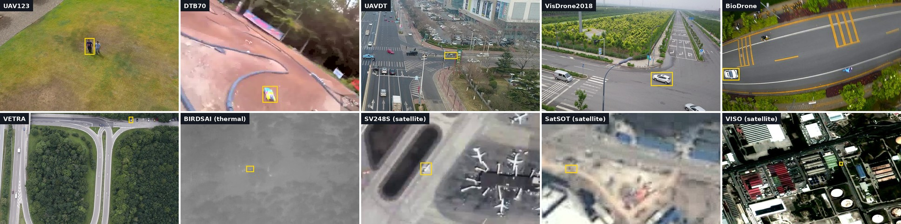

# Results

Unified validation set: 10 datasets × 30 sequences (`eval/manifest.json`), Success AUC (%).
SV248S uses 28 sequences (2 have no first-frame GT; excluded for every method).

  

| Dataset | Type | ORTrack | **Look Twice** | OSTrack (ViT-B) |
|---|---|---:|---:|---:|
| VETRA | manned aircraft, 1 fps | 8.21 | **42.75** | 9.42 |
| BIRDSAI | fixed-wing, thermal | 31.96 | **39.45** | 29.13 |
| BioDrone | flapping-wing drone | 34.37 | **40.92** | 40.57 |
| UAV123 | multirotor | 62.44 | 62.88 | **67.21** |
| DTB70 | multirotor | 70.85 | 70.99 | **72.05** |
| UAVDT | multirotor | 57.11 | 57.93 | **59.37** |
| VisDrone2018 | multirotor | **68.52** | 68.60 | 67.65 |
| SV248S | satellite, tiny | 18.30 | **25.16** | 16.21 |
| SatSOT | satellite, tiny | 34.77 | **37.15** | 37.12 |
| VISO | satellite, tiny | 31.49 | **39.75** | 32.19 |
| **Mean** | | 41.80 | **48.56** | 43.09 |

- Look Twice numbers are without off-screen tracking (`SOT_OOV` off).
- Demo clips are the sequences with the largest Look Twice gain, not typical cases.
- Raw output: `eval/results_subset10.txt`.

## Student tracker (SAM3 distillation)

| Failure | Module | Status |
|---|---|---|
| ① drift to a similar object | identity decoder + SAM3 pointer / memory distillation | implemented, training |
| ② tiny target | native-resolution detail + context features | implemented, training |
| ③ camera shake | multiple position hypotheses | implemented, training |
