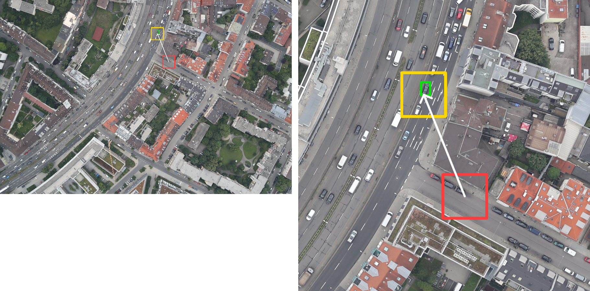
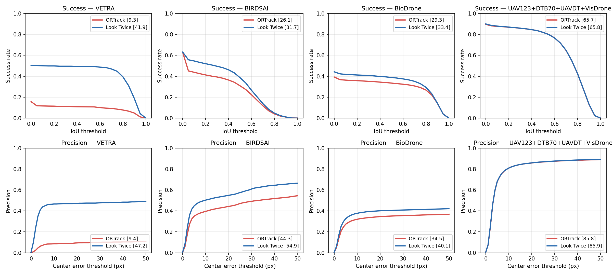

# 급격한 카메라 운동에 강인한 무인기 경량 단일 객체 추적을 위한 이중 가설 검색

*Dual-Hypothesis Search for Lightweight UAV Single Object Tracking under Abrupt Camera Motion*
(가칭 **Look Twice**)

김동훈 · 전북대학교 · ICROS 2026 원고 초안 (2026-11-13)

> **한 줄 요약** — 무인기가 크게 움직이면 경량 추적기의 검색 영역(crop) 밖으로 표적이 튀어 나간다. 카메라가 표적을 따라갔는지 모르니 **직전 위치와 카메라가 움직인 만큼 옮긴 위치를 함께 보고** 더 확실한 쪽을 고른다. 학습도, 조정할 값도 없다.

### 핵심 결과 한눈에

| 구분 | 데이터 | 기준 | + Look Twice | 차이 |
| :-- | :-- | --: | --: | --: |
| 카메라 운동 큼 (AUC) | VETRA (유인기, 1fps) | 11.75 | 41.74 | **+29.99** |
| | BIRDSAI (고정익) | 23.41 | 28.14 | **+4.73** |
| | BioDrone (날갯짓 드론) | 23.88 | 27.53 | **+3.65** |
| 표준 4종 평균 (P/AUC) | DTB70 · UAVDT · VisDrone · UAV123 | 85.5 / 64.8 | 85.7 / 65.0 | +0.2 / +0.2 |
| AVTrack에 적용 (표준 4종 평균) | | 83.8 / 63.7 | 85.5 / 64.8 | **+1.7 / +1.1** |
| 속도 (GPU 단독) | | 346–361 FPS | 112–146 FPS | |

결과 페이지(표·영상): https://claude.ai/artifact/Kk2JSTPfYatCdAi99USnNM

---

## Part 1 · 논문 본문

### 요약

경량 단일 객체 추적기는 직전 위치 주변의 작은 검색 영역(crop)만 관측하므로, 무인기가 급격히 선회하거나 프레임 간 이동이 클 때 표적이 crop 밖으로 벗어나 다른 물체로 옮겨 간다. 실패 분석 결과 회전·고정익 영상에서는 실패의 51–73%가 crop 이탈에서 시작되었다. 카메라(짐벌)가 표적을 따라갔는지 알 수 없다는 점에 착안하여, 직전 위치와 카메라 움직임 보정(CMC) 위치 두 가설을 배치 2로 한 번에 추적하고 점수가 높은 쪽을 택하는 학습 없는 방법을 제안한다. 공개 가중치를 그대로 쓰며 조정할 매개변수가 없고, ORTrack과 AVTrack에 모두 적용된다. ORTrack에 적용하면 카메라 운동이 큰 유인기 1fps(VETRA), 고정익(BIRDSAI), 날갯짓 드론(BioDrone) 영상에서 Success AUC가 각각 +30.0, +4.7, +3.7, Precision이 +35.0, +9.0, +4.8 향상되었고, 표적이 크게 이동한 프레임의 성공률은 BIRDSAI 9.9→25.6%, BioDrone 13.7→26.4%로 높아졌다. 표준 UAV 벤치마크 4종의 평균은 유지되거나 소폭 올랐으며(ORTrack 85.5/64.8→85.7/65.0, AVTrack 83.8/63.7→85.5/64.8), GPU에서 추가 신경망 비용은 거의 없다.

**Keywords** — UAV tracking, single object tracking, camera motion compensation, search region

### 1. 서론

드론 온보드 추적기는 연산 제약 때문에 ORTrack [1] 같은 경량 ViT 추적기를 사용한다. 이들은 직전 박스 주변을 표적 크기의 4배로 잘라 첫 프레임 템플릿과 비교하므로, 표적이 다음 프레임에도 crop 안에 있다고 가정한다. 무인기가 선회·기동하면 화면이 크게 이동하여 이 가정이 깨지고, 추적기는 crop 안의 유사 물체를 표적으로 잡는다.

카메라 움직임을 보정(CMC)해 검색 위치를 옮기는 것이 자연스러운 해법이지만, 짐벌이 표적을 따라가는 영상에서는 배경만 움직이고 표적은 화면에 머물러 오히려 crop을 표적에서 떼어 놓는다. 본 논문은 이 모호성을 두 가설로 동시에 검증하는 단순한 방법을 제안한다. 제안 방법은 학습이 없어 crop 기반 추적기라면 어디에나 붙일 수 있으며, ORTrack [1]과 AVTrack [7]에서 검증하였다.

### 2. 실패 분석

IoU≥0.5로 추적되던 중 IoU<0.1이 5프레임 이상 지속되면 실패로 보고, 시작 시점에 정답 박스가 crop에 완전히 포함되면 IN, 중심이 밖이면 OUT, 나머지를 PARTIAL로 분류하였다.

**표 1.** 실패 시작 위치와 프레임 간 표적 이동 (이동량 = 중심 이동 / 표적 크기)

| 데이터 | 플랫폼 | OUT+PART (%) | 이동량 중앙값 | 표적 크기 이상 이동 (%) |
| :-- | :-- | --: | --: | --: |
| BioDrone | 날갯짓 | 73.2 | 0.43 | 15.7 |
| BIRDSAI | 고정익 | 51 | 0.06 | 3.0 |
| UAV123 | 멀티콥터 | 25.4 | 0.03 | 0.1 |
| UAVDT | 멀티콥터 | 8.7 | 0.03 | 0.2 |
| VETRA | 유인기 1fps | – | 2.44 | 87.3 |

고정익 영상은 평소 이동량이 멀티콥터와 비슷하지만, 선회·재조준 시 표적 크기 이상의 이동이 15–30배 자주 발생하며 이때 crop 이탈이 일어난다.

### 3. 방법

공식 ORTrack-DeiT 가중치를 수정하지 않는다. 매 프레임 배경 특징점(표적 주변 제외)을 LK 광류로 추적하고 RANSAC 호모그래피 H를 추정한다. 직전 박스 중심 c에 대해 두 가설을 둔다.

| 가설 | 의미 | 검색 중심 |
| :-- | :-- | :-- |
| A | 카메라가 표적을 따라감 | c |
| B | 카메라만 움직임 | Hc |

두 crop을 하나의 배치로 묶어 ORTrack을 한 번 실행하고, 점수 지도 최댓값이 큰 쪽의 박스를 출력한다. 학습, 임계값, 운동 모델이 없으며, 카메라가 거의 움직이지 않으면 두 가설이 같아져 원래 ORTrack과 같은 결과를 낸다.

### 4. 실험

평가는 OTB 방식 OPE이며, ORTrack 공식 저장소의 분석 코드로 Precision(중심 오차 20px 이내 비율), Success AUC, Normalized Precision을 계산하였다. 모든 방법은 공개 가중치를 그대로 쓰고 추가 학습하지 않았다. 카메라 운동이 큰 데이터로 VETRA(Test·Validation 차량 트랙 39개를 SOT로 변환), BIRDSAI(48), BioDrone(이미지 해시로 중복을 제거한 분할의 val+test 121)을 사용하였다.

**표 2.** 표준 UAV 벤치마크에서 경량 추적기 비교 (Precision / Success AUC, %). 같은 분석 코드로 재현·계산. Look Twice는 각 추적기에 학습 없이 붙인 결과.

| 추적기 | DTB70 | UAVDT | VisDrone2018 | UAV123 | 평균 |
| :-- | :-: | :-: | :-: | :-: | :-: |
| SGLATrack | 84.1 / 64.9 | 81.8 / 59.8 | 80.5 / 61.7 | 84.9 / 66.9 | 82.8 / 63.3 |
| LETrack | 84.9 / 65.0 | 83.5 / 60.0 | 83.8 / 63.4 | 84.5 / 66.4 | 84.2 / 63.7 |
| AVTrack-D | 84.0 / 65.2 | 82.9 / 59.8 | 84.2 / 63.9 | 82.6 / 65.0 | 83.4 / 63.5 |
| ORTrack-D | 83.8 / 65.2 | 82.6 / 59.7 | 84.9 / 64.0 | 83.8 / 65.8 | 83.8 / 63.7 |
| AVTrack-DeiT | 83.8 / 64.7 | 82.4 / 59.0 | 85.0 / 64.8 | 83.9 / 66.2 | 83.8 / 63.7 |
| **AVTrack-DeiT + Look Twice** | 85.7 / 66.0 | 85.5 / 61.0 | 86.0 / 65.3 | 85.0 / 67.0 | 85.5 / 64.8 |
| ORTrack-DeiT | 86.1 / 66.4 | 83.8 / 60.3 | 87.9 / 66.2 | 84.3 / 66.4 | 85.5 / 64.8 |
| **ORTrack-DeiT + Look Twice** | 86.5 / 67.0 | 84.6 / 60.6 | 87.7 / 66.2 | 83.9 / 66.1 | 85.7 / 65.0 |

**표 3.** 카메라 운동이 큰 영상 (Success AUC / Precision / Normalized Precision, %)

| 추적기 | VETRA (유인기 1fps) | BIRDSAI (고정익) | BioDrone (날갯짓) |
| :-- | :-: | :-: | :-: |
| ORTrack-DeiT | 11.8 / 11.9 / 16.8 | 23.4 / 39.3 / 40.4 | 23.9 / 28.2 / 48.6 |
| **ORTrack-DeiT + Look Twice** | 41.7 / 46.8 / 52.2 | 28.1 / 48.2 / 46.4 | 27.5 / 33.0 / 53.2 |
| AVTrack-DeiT | 12.2 / 12.4 / 17.3 | 22.7 / 38.9 / 40.4 | 21.8 / 25.7 / 46.2 |
| **AVTrack-DeiT + Look Twice** | 36.2 / 42.0 / 46.0 | 27.5 / 48.6 / 46.0 | 24.4 / 29.4 / 49.5 |

두 추적기 모두 세 데이터에서 크게 향상되었다. Precision의 상승폭이 AUC보다 커서, 박스 크기보다 표적 위치를 놓치지 않는 것이 주로 개선되었다.

**표 4.** 큰 움직임 프레임(정답 표적이 직전 프레임 대비 표적 크기 이상 이동)에서의 성공률 (IoU>0.5, %, ORTrack-DeiT 기준)

| 데이터 | 해당 프레임 | ORTrack | + Look Twice | 차이 |
| :-- | --: | --: | --: | --: |
| VETRA | 1,254 (87%) | 7.4 | 52.9 | **+45.5** |
| BIRDSAI | 893 (3.0%) | 9.9 | 25.6 | **+15.8** |
| BioDrone | 9,208 (19.7%) | 13.7 | 26.4 | **+12.7** |
| 멀티콥터 4종 합계* | 274 (0.1–0.6%) | 25.9 | 40.9 | **+15.0** |

\*UAV123, DTB70, UAVDT, VisDrone2018. 표준 벤치마크의 평균 차이가 작은 것은 이러한 프레임이 0.1–0.6%뿐이기 때문이며, 해당 프레임에서는 큰 폭으로 향상된다.

**표 5.** 구성 요소 분석 (ORTrack-DeiT, Success AUC / Precision, %)

| 구성 | VETRA | BIRDSAI | BioDrone | DTB70 | VisDrone2018 |
| :-- | :-: | :-: | :-: | :-: | :-: |
| A만 (= ORTrack) | 11.8 / 11.9 | 23.4 / 39.3 | 23.9 / 28.2 | 66.4 / 86.1 | 66.2 / 87.9 |
| B만 (CMC 위치만) | 41.7 / 48.3 | 30.2 / 52.3 | 26.6 / 31.6 | 67.0 / 86.7 | 64.6 / 85.8 |
| **A+B (제안)** | 41.7 / 46.8 | 28.1 / 48.2 | 27.5 / 33.0 | 67.0 / 86.5 | 66.2 / 87.7 |
| A+B, 위상 상관 CMC | 37.6 / 42.3 | 28.9 / 49.1 | 26.4 / 31.7 | 67.2 / 87.3 | 65.3 / 86.8 |
| A+B + 누적 선택 피드백 | 41.6 / 46.6 | 29.8 / 50.2 | 27.6 / 33.1 | 67.5 / 87.3 | 65.5 / 86.8 |

B만 쓰면 카메라만 움직이는 영상(BIRDSAI)에서는 더 높지만, 짐벌이 표적을 따라가는 VisDrone에서 −1.6 떨어진다. 두 가설을 함께 보는 구성만 모든 데이터에서 손해가 없다. 가벼운 위상 상관 CMC도 대부분 비슷하여 온보드 대안이 될 수 있다. 표적 운동까지 예측하는 등속 칼만 필터를 더한 구성은 VisDrone에서 −5.6으로 크게 떨어져 제외하였다.

**표 6.** 그 밖의 벤치마크 (ORTrack-DeiT, Success AUC / Precision, %)

| 데이터 | ORTrack | + Look Twice |
| :-- | :-: | :-: |
| DynUAV† (CVPR 2026) | 62.8 / 88.3 | 62.9 / 88.5 |
| SV248S (위성) | 16.9 / 44.5 | 16.8 / 44.2 |
| SatSOT (위성) | 38.0 / 54.7 | 37.7 / 53.6 |
| VISO (위성) | 32.5 / 66.7 | 32.5 / 65.9 |

†공격적 기동 데이터. test MOT 트랙 42개를 SOT로 변환. 표적 크기 대비 프레임 간 이동은 작아(표적 크기 이상 0.3%) crop 이탈이 드물었다.

**표 7.** 속도 (ORTrack-DeiT, 같은 GPU·CPU)

| 항목 | ORTrack | + Look Twice |
| :-- | --: | --: |
| 신경망, GPU (배치 1 / 2) | 2.01 ms | 2.03 ms |
| 신경망, CPU 4스레드 | 24.5 ms | 44.7 ms |
| CMC (CPU, 1440×1080→640폭) | – | 3.8 ms |
| 전체 추적, GPU 단독 | 346–361 FPS | 112–146 FPS |
| 전체 추정, CPU | 40.8 FPS | 20.6 FPS |

GPU에서는 두 가설을 배치로 처리해 추가 신경망 비용이 거의 없고, 증가분의 대부분은 CMC이다. CPU에서는 신경망 비용이 약 1.8배가 된다.

### 5. 한계와 향후 연구

표적 자체가 한 프레임에 표적 크기의 1.5배 넘게 움직이면 두 가설 모두 표적을 담지 못한다. CPU에서는 두 번째 가설이 신경망 비용을 약 1.8배로 늘리므로, 온보드에서는 카메라 운동이 클 때만 가설 B를 보는 조건부 실행이 필요하다. ORTrack 점수는 표적 소실을 구분하지 못해(정상 프레임 5% 오판 시 실패 15%만 검출) 소실 후 재탐색을 넣으면 오히려 성능이 떨어졌다. 향후 SAM3를 교사로 표적 존재 점수와 특징을 증류하여 소실 판단·재탐색과 구조 경량화를 함께 다루고, 작은 표적에서 ORTrack의 최소 박스 제한(10px) 문제를 해결하며, Hailo-8 온보드 실시간성과 IMU 기반 카메라 운동 추정을 검증할 예정이다. 카메라·표적 운동을 분리하는 선행연구 [2]와의 정량 비교가 필요하다.

### 6. 결론

무인기의 큰 회전이 경량 추적기 실패의 주된 원인임을 보이고, 카메라 추종 여부의 모호성을 두 검색 가설로 동시에 검증하는 학습 없는 방법으로 회전·고정익·유인기 영상의 성능을 크게 높이면서 표준 벤치마크 성능을 유지하였다.

### 참고문헌

1. Y. Wu et al., "Learning Occlusion-Robust Vision Transformers for Real-Time UAV Tracking," CVPR, 2025.
2. SiamMDTP: "A UAV tracking framework via motion-decoupled trajectory prediction and occlusion handling," Information Sciences, 2026, doi:10.1016/j.ins.2025.122784.
3. N. Aharon, R. Orfaig, B.-Z. Bobrovsky, "BoT-SORT: Robust Associations Multi-Pedestrian Tracking," arXiv:2206.14651, 2022.
4. X. Zhao et al., "BioDrone: A Bionic Drone-based Single Object Tracking Benchmark for Robust Vision," IJCV, 2024.
5. E. Bondi et al., "BIRDSAI: A Dataset for Detection and Tracking in Aerial Thermal Infrared Videos," WACV, 2020.
6. J. Hellekes et al., "VETRA: A Dataset for Vehicle Tracking in Aerial Imagery," ECCV, 2024.
7. Y. Wu et al., "Learning Adaptive and View-Invariant Vision Transformer for Real-Time UAV Tracking (AVTrack)," ICML, 2024.

---

## Part 2 · 연구 노트 — 무엇 때문에 무엇을 했나

### 2.1 문제 정의

1. **무인기가 크게 회전하면 표적이 순간적으로 crop 밖으로 나가 다른 물체로 옮겨 간다.** 고정익뿐 아니라 회전익도 마찬가지 → **이번 논문의 주제**
2. 작은 객체를 못 잡는다 → ICROS 이후
3. 경량화(프루닝·증류, Hailo) → ICROS 이후

### 2.2 데이터 결정

| 결정 | 이유 |
| :-- | :-- |
| BioDrone 기존 분할 폐기 → 이미지 해시로 중복을 제거한 분할 v1 | 기존 train/val/tune에 같은 JPEG가 있어 누수 |
| BioDrone은 평가 전용 | 회전 심한 영상에 대한 일반화를 순수하게 확인 |
| LaTOT·유튜브 고정익 제외 | 사용자 결정 (유튜브는 쓸 수 있는 샷 23/252) |
| AI Hub는 고정익 아님 | 비행 속도 중앙값 6.5 m/s(멀티콥터) |
| 실제 고정익 = BIRDSAI | 바로 쓸 수 있는 유일한 공개 고정익 실영상(열화상) |
| VETRA 추가 | 비행기·헬기 1fps, 표적이 프레임마다 표적 크기의 2.4배 이동 → 문제 1의 극단 사례 |
| DynUAV 추가 | CVPR 2026 공격적 기동 데이터 |
| 위성 3종 추가 | 작은 객체(4–12px) 확인용 |
| SEAGULL·VIVID·CLIF·WPAFB·CrossTrack 미사용 | 사용자 판단 / 서버 고장 / 등록 필요 / 저자 무응답 |

- **평가셋**(학습에 쓰지 않음): VETRA 39 · BIRDSAI 48 · BioDrone 121 · UAV123 123 · DTB70 70 · UAVDT 50 · VisDrone2018 35 · DynUAV 42 · SV248S 248 · SatSOT 105 · VISO 44 (약 50만 프레임)
- **설정 선택**: VisDrone-SOT val(11)에서만

### 2.3 방법의 변천

| 단계 | 한 일 | 결과 | 버린·바꾼 이유 |
| :-- | :-- | :-- | :-- |
| ① 주변시야 가지 | ORTrack 옆에 축소 전체 화면을 보는 학습 가지 | BioDrone val +4.7 | BioDrone 학습 의존, 데이터셋 움직임 암기 |
| ② 상태 흐름 v0 | 존재 판단 → 놓침 → 재탐색 | val −3~−15 | 놓침 오판, 복귀 실패 |
| ③ v1: CMC+KF+교체 | 의심 시만 재탐색·교체 | BIRDSAI +5.5 / VisDrone −4.1 | 표준 셋 손해 |
| 원인 분석 | 장치 하나씩 끄고 비교 | 모두 끔 = ORTrack(+0.00), KF만 −5.6 | **KF가 짐벌 추종 영상에서 crop을 밀어냄** → 제거 |
| ④ v2: 두 위치 + 교체 | 크게 움직일 때 두 곳 | VETRA +35, VisDrone −2.5 | 닮은 차로 잘못 교체 |
| ⑤ v3·v4 | 방해물 기억, 최소 박스 자동 | 일부 개선, 일부 손해 | 장치가 너무 많음 |
| ⑥ 가설 트리 | 여러 가설 지연 결정 | val 61.1 < v2 63.9 | 가설이 거의 유지 안 됨 |
| ⑦ DAM4SAM식 다시 찾기 | 기억 + 보류 + 확대 | val 24~50 | ORTrack 점수로 놓침 판단 불가 |
| **⑧ 최종: Look Twice** | **두 위치 배치 2, 점수 높은 쪽** | **표 2–4** | "심플 이즈 베스트" |
| (보류) 누적 피드백 α | 영상별로 CMC가 맞아 온 정도 기억 | 회전 +2~3 / 표준 −0.6~−1.9 | 다음 연구 |
| ⑨ 조건부 B (11-14) | CMC 이동이 crop 1/8 미만이면 B 생략 | 표준 B 실행 0.1~5%로 감소, BIRDSAI −1.9·BioDrone −2.3 | 작은 이동에서도 B가 도움 → 기각 |
| ⑩ 경량 CMC (11-14) | 320px·nearest 축소·특징점 재사용 | VETRA −2.7 | 정확도 손해 → 기각 |
| ⑪ 기억 가설 C (11-14) | 마지막 확실한 위치를 H로 옮겨 세 번째로 경쟁 | BioDrone +1~3, 표준 최대 −7.8 | 방해물로 잘못 복귀 → 기각 |
| **⑫ 화면 밖 추적 (11-14)** | **표적 위치를 H로 화면 밖까지 기억, 밖이면 정지, 들어오면 그 자리 검색** | **BioDrone 27.5→32.8, 표준 ±0.2** | 문제 ② 해법 (2.5 참고) |

### 2.4 추가 결과

**대표 세트(데이터별 30 seq) 구성 비교** — ORTrack 대비 AUC 차이

| 데이터 | v4 (복잡) | Look Twice | + 피드백 | + 최소 박스 자동 |
| :-- | --: | --: | --: | --: |
| VETRA | – | +34.54 | +34.16 | +34.54 |
| BIRDSAI | +5.26 | +6.40 | +9.25 | +7.48 |
| BioDrone | +4.52 | +6.55 | +7.26 | +6.55 |
| UAV123 | – | +0.44 | −1.86 | +0.44 |
| DTB70 | −1.70 | +0.14 | +0.26 | +0.14 |
| UAVDT | – | +0.93 | −0.63 | +0.82 |
| VisDrone2018 | −1.27 | +0.08 | −0.76 | +0.08 |
| SatSOT | +2.05 | −1.36 | −0.07 | +2.38 |
| VISO | +8.87 | −0.11 | −0.20 | +8.26 |

**작은 객체 참고 — 최소 박스 10px → 1px** (전체 셋, AUC)

| 데이터 (표적 중앙값) | ORTrack 10px | ORTrack 1px |
| :-- | --: | --: |
| VISO (6.9px) | 32.32 | 40.22 |
| SatSOT (12px) | 38.67 | 40.26 |
| UAVDT (27px) | 60.18 | 59.68 |

→ 작은 표적에서는 ORTrack의 최소 박스 제한 자체가 손해. `min(10px, 첫 프레임 표적 짧은 변)` 규칙으로 해결 가능(다음 연구).

**놓침 판단의 한계** (VisDrone-SOT val, ORTrack 점수 기준)

| 기준 τ | 정상 프레임 오판 | 실제 실패 검출 |
| :-- | --: | --: |
| 0.3 | 1.6% | 6.8% |
| 0.4 | 5.3% | 15.4% |
| 0.5 | 14.8% | 31.1% |

**교사 후보** (BioDrone test 15 + BIRDSAI 15 seq, AUC)

| 추적기 | BioDrone | BIRDSAI | 비고 |
| :-- | --: | --: | :-- |
| **SAM3** | 73.2 | **48.0** | 교사로 선택(30개 평균 1위) |
| DAM4SAM | **75.9** | 44.4 | 화면 밖 재진입을 유일하게 잡음 |
| SAMURAI | 70.7 | 45.1 | |
| SAM2.1-L | 69.9 | 44.4 | |

### 2.5 문제 ② 화면 밖 이탈과 다시 찾기 (2026-11-14)

**Look Twice 이후 남은 실패 분류** (실패 시작 = 직전 IoU>0.5 → 이후 3프레임 IoU<0.1)

| 데이터 | 실패 수 | 정답 안 보임 | 모든 crop 밖 | 고른 crop 안 방해물 | 다른 가설 crop 안 | 이후 회복 |
| :-- | --: | --: | --: | --: | --: | --: |
| BIRDSAI | 104 | 53% | 4% | 40% | 3% | 88% |
| BioDrone | 192 | 55% | 2% | 38% | 5% | 63% |
| VisDrone2018 | 17 | 0% | 0% | 100% | 0% | 59% |

→ crop 이탈(문제 ①)은 Look Twice로 2~4%까지 줄었다. 남은 실패의 절반 이상은 **정답이 화면에서 사라진 경우**다.

**사라진 구간 분석**

| 데이터 | 화면 가장자리로 사라짐 | 다시 나타난 뒤 즉시(≤2f) 회복 | 회복 못함 |
| :-- | --: | --: | --: |
| BIRDSAI | 24% | 65% (화면 안에서 사라진 경우 77%) | 11% |
| BioDrone | **99%** | 23% | **34%** |

→ 진동이 심한 BioDrone은 표적이 화면 밖으로 나갔다 들어오기를 반복하고, 그동안 추적기는 화면 안의 다른 물체로 옮겨 가 돌아오지 못한다.

**점수로는 놓침을 판단할 수 없음** (안 보임 vs 정상 추적 프레임, 점수 AUROC): BIRDSAI 0.73, BioDrone 0.80. 정상 프레임 오판을 5%로 맞추면 안 보임 검출은 12% / 46%뿐이다. 그래서 위치로 판단한다.

**화면 밖 추적 (Out-of-view tracking)** — `SOT_OOV=1 SOT_OOV_G=1.0`
1. 추적 중에는 가상 위치 v = 추적 중심.
2. 매 프레임 v를 CMC의 H로 옮긴다(화면 밖이어도 계속).
3. v의 박스가 화면 밖으로 완전히 나가면 추적을 멈춘다(박스는 가장자리에 둠). 방해물로 옮겨 가지 않는다.
4. v가 다시 화면 안에 들어오면 v와 CMC 위치에서 검색한다.
5. 짐벌 추종 오판 방지: 화면 밖 상태에서도 마지막 추적 위치를 crop 하나로 확인하고, 점수가 평소 점수(EMA) 이상이면 화면 밖 판단을 취소한다. (취소 없는 버전은 '화면 밖' 판단의 53~66%가 실제로는 보이는 표적이었다.)

학습·추가 신경망 없음. 화면 밖 상태에서는 crop 1개만 보므로 오히려 가볍다.

**결과** (ORTrack 공식 분석 코드, Success AUC / Precision / Norm. Precision)

| 데이터 | ORTrack | + Look Twice | + 화면 밖 추적 |
| :-- | :-: | :-: | :-: |
| BioDrone | 23.9 / 28.2 / 48.6 | 27.5 / 33.0 / 53.2 | **32.8 / 39.9 / 59.3** |
| VETRA | 11.8 / 11.9 / 16.8 | 41.7 / 46.8 / 52.2 | **42.2 / 47.5 / 52.6** |
| BIRDSAI | 23.4 / 39.3 / 40.4 | 28.1 / 48.2 / 46.4 | **28.6 / 48.9 / 46.9** |
| DTB70 | 66.4 / 86.1 / 81.7 | 67.0 / 86.5 / 81.3 | 66.8 / 86.3 / 81.1 |
| UAVDT | 60.3 / 83.8 / 69.4 | 60.6 / 84.6 / 69.8 | 60.6 / 84.6 / 69.8 |
| VisDrone2018 | 66.2 / 87.9 / 83.4 | 66.2 / 87.7 / 83.3 | 66.2 / 87.7 / 83.3 |
| UAV123 | 66.4 / 84.3 / 82.2 | 66.1 / 83.9 / 81.8 | 66.1 / 83.9 / 81.8 |

**프레임당 검색 crop 수** (Look Twice = 2.00): BioDrone 1.77 (화면 밖 정지 22.8%), VETRA 1.92, BIRDSAI 1.96, 표준 4종 1.99~2.00.

**왜 BioDrone만 크게 오르나**
- BioDrone: 사라질 때 99%가 화면 가장자리 → 화면 밖 추적이 푸는 상황 그대로.
- BIRDSAI: 사라질 때 화면 가장자리는 24%, 화면 밖 정지 4.2% → 대부분 화면 안에서 사라짐(가림·너무 작아 정답 미표시로 추정). 화면 안 재등장은 이미 77% 즉시 회복. 남은 40%는 열화상의 비슷한 흰 점(사람·동물)으로 옮겨 가는 외형 구별 문제.
- VETRA: 고해상도 광역이라 화면 밖 이탈 적음(7.7%). 문제는 1fps의 큰 이동이고 Look Twice가 해결.
- 표준 4종: 화면 밖 0~1.2%라 거의 발동 안 함.

**남은 문제**: crop 안 비슷한 물체로 옮겨 감(BIRDSAI 40%, BioDrone 38%). 위치로는 못 풀고 표적·방해물 구별이 필요 → SAM3 증류(IJCAS).

### 2.6 다음 연구

1. **SAM3 증류**: 표적·방해물 구별 특징 → crop 안 방해물 전이(남은 실패의 38~40%) 해결, 화면 안에서 사라진 표적 다시 찾기
2. **작은 객체**: 최소 박스 규칙, 고해상도 crop
3. **경량화**: Taylor 프루닝 + 증류, INT8, Hailo-8 실측
4. **CMC 경량화**: 위상 상관(정확도 동일 확인) 또는 IMU·짐벌 텔레메트리
5. 누적 피드백 α 세기 조절, 가설 B에 표적 자체 이동 반영
6. SiamMDTP 정량 비교, KDI 자체 비행 데이터 평가

### 2.7 재현

| 항목 | 위치 |
| :-- | :-- |
| 추적기 | `SOT/ORTrack/lib/test/tracker/sm_track.py` → `track_simple` |
| 실행 | `SOT_SIMPLE=1 SOT_MOTION=cmc SOT_FLOOR=10 SOT_FB=0 python test.py ortrack deit_tiny_patch16_224 ...` |
| + 화면 밖 추적 | 위에 `SOT_OOV=1 SOT_OOV_G=1.0` 추가 (runid 65xx) |
| 실패 분석 | `fail_types.py`, `invis_seg.py`, `vis_auc.py`, `oov_check.py` (runid 62xx 기록 필요: `SOT_GATE_LOG=1 SOT_SEL_LOG=1 SOT_SM_LOG=...`) |
| CMC | `SOT/ORTrack/lib/test/tracker/motion_prior.py` → `MotionPrior('cmc')` |
| 평가 뷰 | `SOT/analysis/{vd,birdsai,sat,vetra,dynuav}_view_20261113/` |
| 채점·실행 스크립트 | `SOT/analysis/sm_calib_20261113/`, `SOT/analysis/subset_20261113/` |
| 그림 | `fig1_dual_hypothesis.png` |
