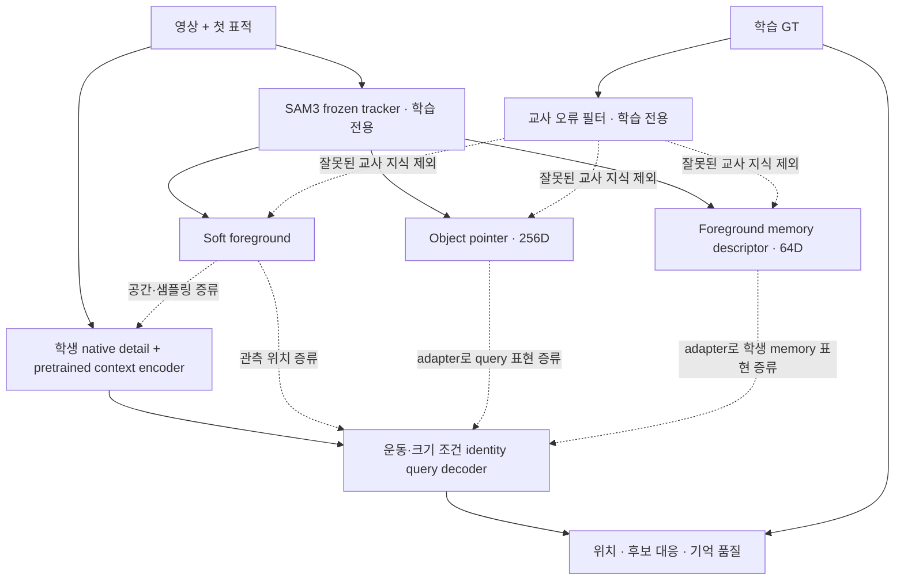

# SAM3 knowledge-distilled recovery tracker — research prototype

목표: 작은 표적, 큰 카메라 흔들림, 놓친 뒤 다른 물체로의 오추적을 줄이는 IJCAS 연구. **주모델은 SAM3 지식증류 학생이며 GT-only는 대조군이다.** 현재 구현은 연구 prototype이고 성능이 검증된 최종 추적기가 아니다.


## 지식증류 구조

학습 전용 frozen SAM3는 첫 프레임 GT 박스 한 번으로 causal propagation한다. 이후 GT로 teacher를 재초기화하거나 미래 프레임으로 역추적하지 않는다. 실제 `obj_ptr`, `maskmem_features`, soft mask를 저장한다. 현재 코드는 SAM3의 PVS tracker 경로를 사용하며, 텍스트 기반 detector나 전체 PCS 재탐색을 호출하지 않는다.



- 공간 KD: 실제 soft foreground → 학생 foreground map. tiny target이 pooling으로 사라지지 않게 fractional occupancy를 유지한다.
- 관측 KD: 교사 foreground의 공간 분포 → proposal head, 실제 query sampling coordinates에서 교사 전경을 읽도록 coverage loss. 좌표까지 gradient가 흐르는 것을 별도 검사한다. 모든 sparse point가 표적에서 멀면 coverage gradient가 사라질 수 있어 dense proposal supervision을 병행한다.
- 표현 KD: 학생 selected-query → 학습용 256D adapter → SAM3 `obj_ptr`와 normalized cosine loss.
- 기억 KD: 학생 foreground-weighted memory feature → 학습용 64D adapter → 실제 SAM3 foreground memory descriptor와 normalized cosine loss.
- 시간 관계 KD: 학생 query–초기 anchor cosine과 교사 current pointer–initial pointer cosine을 맞춘다. `obj_ptr`가 우리 도메인에서 좋은 ReID embedding이라는 보장은 없으므로 별도 audit가 필요하다.
- GT는 기본 위치·후보·품질 학습 및 **학습 teacher의 IoU 품질 검사**에 사용한다. GT 박스와 teacher 박스를 동시에 regression하는 것만을 핵심 기여로 삼지 않는다.
- Teacher box IoU>=.5인 labelled train frame만 KD에 사용한다. 박스 KD는 teacher가 학생보다 .05 이상 나은 경우만 적용한다. 빈 teacher는 unknown이며 no-match 정답으로 쓰지 않는다. 이 수치들은 첫 진단의 고정 설정이며 최적화/캘리브레이션 결과가 아니다.
- 추론에서 SAM3·teacher cache·현재 GT는 사용하지 않는다. 표현 KD adapter는 eval forward에서 실행하지 않는다.

이 구성이나 loss 이름이 곧 신규성은 아니다. ORTrack AFKD는 동형 backbone 마지막 token MSE이며, LoReTrack도 QKV와 판별 영역 증류를 다룬다. 제안 관측–표현–기억 연결은 이들과 같은 조건에서 비교해야 한다.

## 파일

- `student.py`: 영상 → 세부/context 특징 → 운동 가설 → query decoder → 박스/대응/품질.
- `query_decoder.py`: multilevel sparse sampling과 memory attention.
- `losses.py`: GT supervision, output/observation/representation/memory KD.
- `data.py`: frozen source split, 원본 좌표 정렬, teacher cache 검증.
- `train.py`: 같은 초기값·순서의 소규모 진단 학습. 기본 condition은 수정된 **coordinates**.
- `runtime.py`: 첫 박스만 사용하는 인과적 학생 추적.
- `evaluate.py`: source-separated 연속 추적, 원본 OSTrack 비교.
- `evaluate_pairs.py`: 과거 baseline 박스를 쓰는 단일 step 진단. OPE와 구분.
- `check_student.py`, `check_decoder.py`: gradient·teacher detach·invalid observation 검증.

## 실행

워크스페이스 루트에서 실행한다. 기존 패키지를 교체하지 않고 로컬 dependency 경로를 사용한다.

```bash
export PYTHONPATH="$PWD/SOT:$PWD/SOT/pydeps"
python -m recovery_tracker.check_student

# 실제 SAM3 knowledge export. 아래 과정에서만 SAM3가 필요하다.
PYTHONPATH="$PWD/SOT/pydeps_sam:$PWD/SOT/pydeps" \
  python SOT/analysis/icml_20261120/run_pilot.py --mode sam3 --knowledge

# 주모델: SAM3 공간 + 관측 + 표현 + 기억 지식증류
python -m recovery_tracker.train --conditions knowledge --steps 240 \
  --out SOT/analysis/redesign_20261120/training_knowledge_v1

python -m recovery_tracker.evaluate \
  --checkpoint SOT/analysis/redesign_20261120/training_knowledge_v1/knowledge/checkpoint.pt \
  --out SOT/analysis/redesign_20261120/evaluation_knowledge_v1
```

## 현재 실험 범위와 실패

복구된 BIRDSAI TrainReal 8개 짧은 thermal clip을 6 train-source / 2 validation-source로 나눴다. 이 clip들은 과거에 모두 관찰한 탐색 데이터이며 독립 test가 아니다. raw RGB 데이터 복구·정식 학습은 남아 있다.

첫 output/observation KD 240-step 진단에서는 학생이 연속 추적 중 거의 계속 no-match를 선택했다. 이는 성공한 추적기나 증류 성과가 아니다. 과거 baseline 박스로 학습한 상태 분포와 학생 자신의 연속 상태 분포가 다르며, cold-start proposal/localization과 memory admission을 함께 진단해야 한다. 새 표현 KD를 붙인 것만으로 이 문제가 해결됐다고 주장하지 않는다.

원본 OSTrack은 깨끗한 worktree를 유지했다. 최신 PyTorch에서 제거된 `torch._six`의 사용하지 않는 loader import만 평가 프로세스 안에서 shim으로 처리하고, 원본 tracking rule은 바꾸지 않았다.
